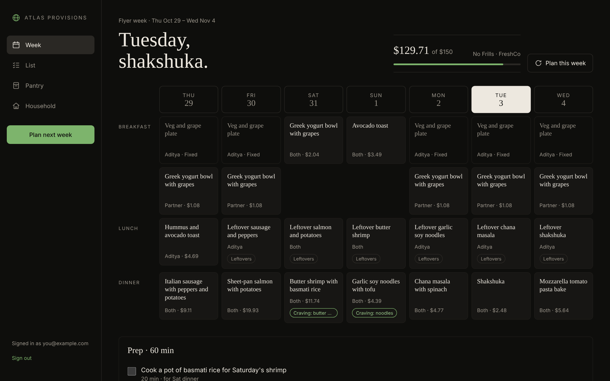
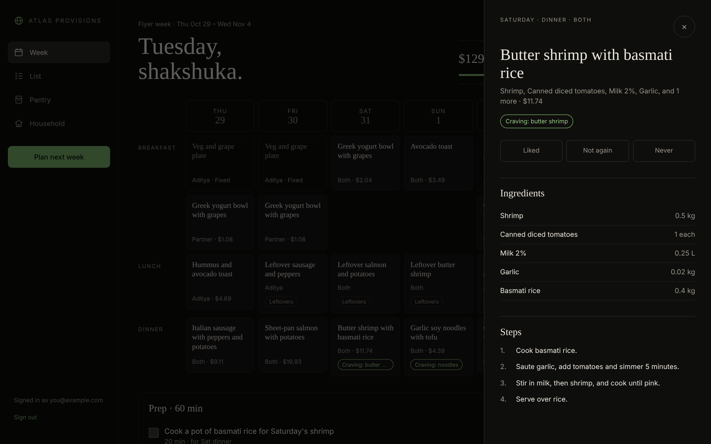
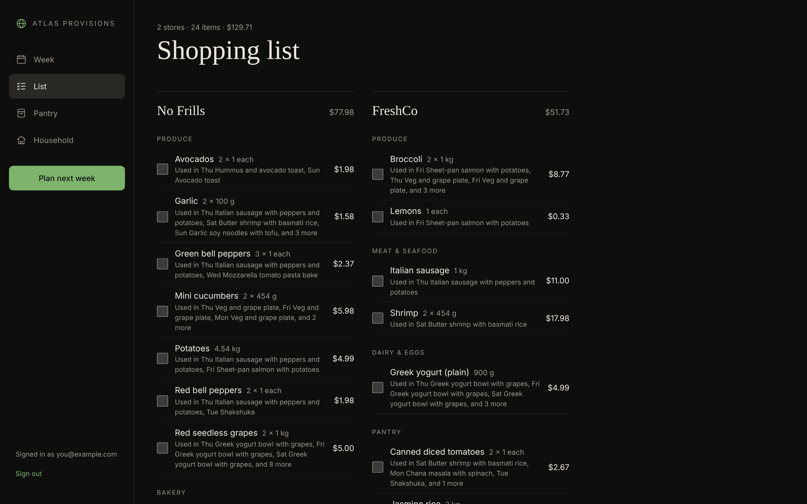
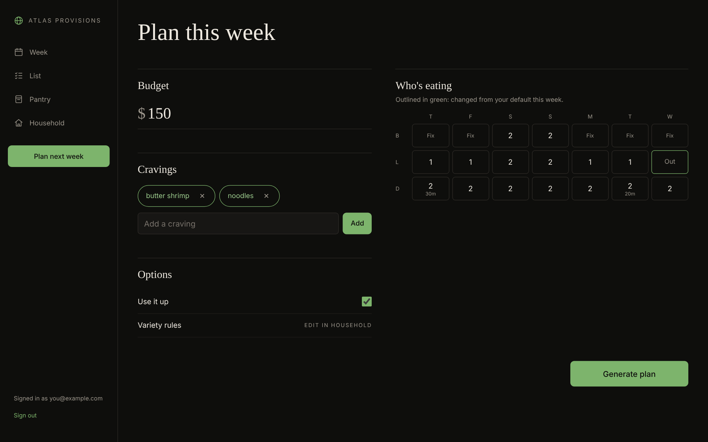
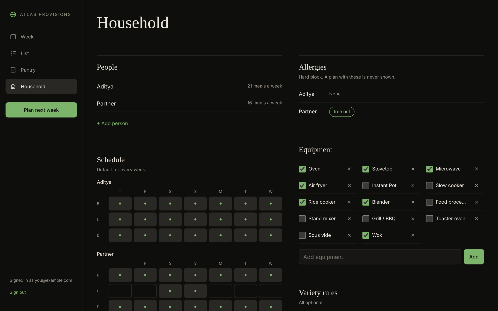
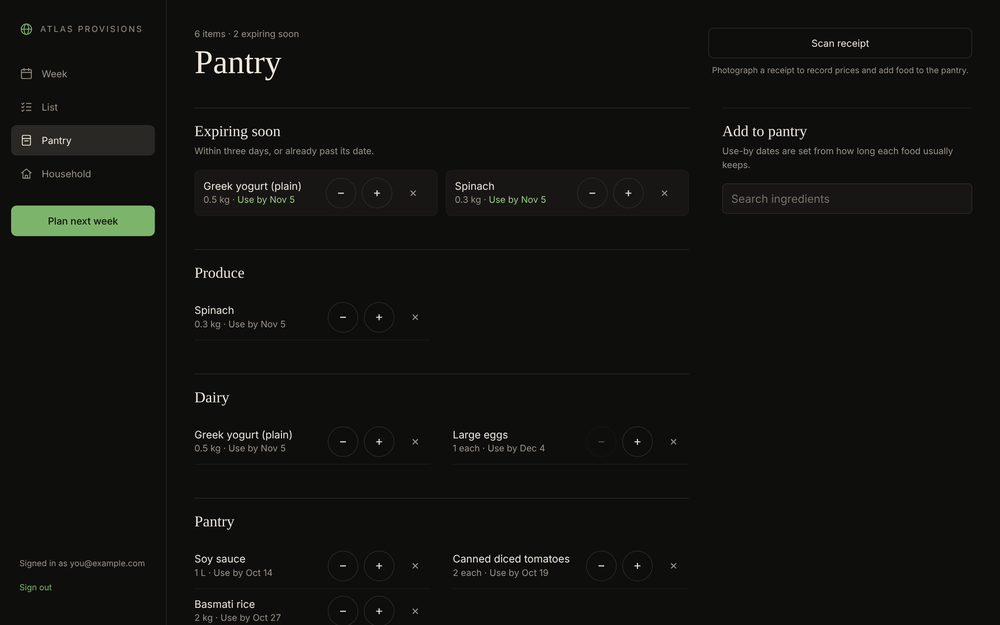
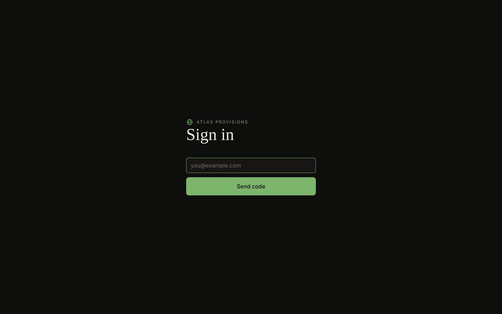
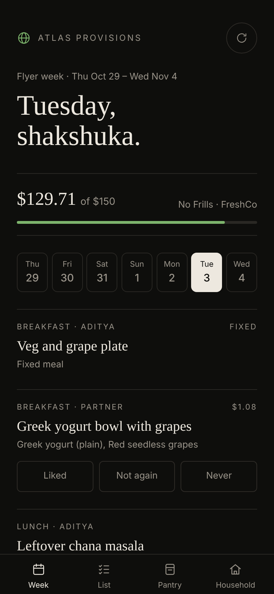

# Atlas Provisions

Atlas Provisions plans a household's week of home-cooked meals around local grocery flyer deals, a budget, and what people in the house can and cannot eat.



## What it does

- Scores the week's flyer deals and keeps a shortlist of the best value per category.
- Plans the week with one Claude call that returns the meals and a batch-prep list together. The code then checks the plan (budget, allergies as a hard block, never-buy items, macros, waste, busy-night time caps, cravings, optional variety rules) and asks for a fix when a check fails, up to 3 attempts.
- Builds a shopping list grouped by store, with price-match hints when another store is cheaper, and a separate section for items no flyer covers.
- Keeps household defaults (people, eating schedule, fixed meals, equipment, allergies, time caps) and lets you change a single week (guests, eating out, shared meals) without changing the defaults.
- Tracks the pantry, with use-by dates, and can prefer ingredients that are about to expire ("use it up").
- Scans receipts with Claude vision (the same reader as Atlas Journeys) to record prices and add food to the pantry.
- Takes ratings on meals, so liked meals can come back and disliked ones are skipped.
- Signs in with an email code for an allow-list of addresses.

## Screens

<table>
  <tr>
    <td width="50%"><br>Meal detail: ingredients, steps, and a rating for the people eating it.</td>
    <td width="50%"><br>Shopping list: one column per store, with used-in notes and price-match hints.</td>
  </tr>
  <tr>
    <td width="50%"><br>Plan: budget, cravings, and who is eating each meal. Changed cells are outlined in green.</td>
    <td width="50%"><br>Household: people, schedule, allergies, equipment, and variety rules.</td>
  </tr>
  <tr>
    <td width="50%"><br>Pantry: what is on hand, with use-by dates and items expiring soon.</td>
    <td width="50%"><br>Sign in: an email code, for addresses on the allow-list only.</td>
  </tr>
</table>

<p align="center">
  <br>
  Works on phones too.
</p>

## How it works

1. **Ingest.** Flyer items are read into a common shape: store, name, price, size, and valid dates. The Flipp flyer import is not built yet, so sample fixtures in `worker/fixtures/` stand in for real flyers.
2. **Normalize.** Each flyer name is matched to an ingredient in the catalogue by its aliases and size is converted to the ingredient's unit (kg, L or each). A Claude fallback for names the matcher cannot place is planned; the interface exists and is not wired up.
3. **Score.** Each ingredient keeps its cheapest unit price per store, measured against recent price history. Never-buy items are dropped, always-buy items are added, and the top 8 per category go to the planner.
4. **Plan.** One Claude call returns the meals for each slot and the batch-prep list for the prep day. Quantities are in each ingredient's unit, and the code, not the model, computes the cost.
5. **Validate.** The plan is checked in code. A failed check, such as a plan over budget or an allergen in a dish, is fed back to the model for another attempt, up to 3 attempts. A plan with errors is shown with the errors listed.
6. **List.** The saved plan becomes a shopping list: quantities are rounded up to whole packs, pantry stock is taken off first, and each item is placed at its cheapest enabled store.

## Stack

- Web: React, Vite, Tailwind CSS, React Router.
- Worker: Hono on Cloudflare Workers, with a D1 database (SQLite) for households, deals, plans, pantry, ratings and sessions.
- Shared: TypeScript types, zod schemas and the planning logic, used by both the web app and the Worker.
- Tests: vitest.

Models, each read from an environment variable with the default shown:

| Job | Variable | Default |
| --- | --- | --- |
| Weekly plan | `PLANNER_MODEL` (set in `wrangler.jsonc`) | `claude-sonnet-5-5` |
| Batch-prep regenerate | `PREP_MODEL` | `claude-haiku-5-5` |
| Receipt reading | `RECEIPT_MODEL` | `claude-sonnet-5-5` |
| Receipt fallback | `EXTRACT_MODEL` | `claude-haiku-5-5` |

The Anthropic key is `ANTHROPIC_API_KEY`, a Worker secret.

## Deploy

A GitHub Actions workflow (`.github/workflows/deploy.yml`) runs on every push to `main`. It typechecks, creates the D1 database `atlas-provisions` if it does not exist, applies migrations to the remote database, builds the web app, and deploys the Worker to `adityajain.ca/provisions*`.

GitHub repository secrets:

- `CLOUDFLARE_API_TOKEN`: a token from the "Edit Cloudflare Workers" template, with the Account > D1 > Edit permission added, and the zone `adityajain.ca`.
- `CLOUDFLARE_ACCOUNT_ID`: your Cloudflare account ID.

Worker secrets (Cloudflare dashboard: Workers & Pages > atlas-provisions > Settings > Variables and Secrets, type Secret):

- `ANTHROPIC_API_KEY`: the Claude API key for planning and receipts.
- `ALLOWED_EMAILS`: comma-separated addresses that may sign in, for example `you@example.com`. Each address must be a verified destination in Cloudflare Email Routing, or the sign-in email is not delivered.

`MAIL_FROM` and `PLANNER_MODEL` are variables in `wrangler.jsonc`.

## Local development

```sh
npm install
cp .dev.vars.example .dev.vars            # DEV=1, ALLOWED_EMAILS, DEV_AUTH_EMAIL
npx wrangler d1 migrations apply atlas-provisions --local
npx wrangler dev --port 8787              # terminal 1: the Worker and local D1
npm run dev                               # terminal 2: Vite dev server
```

Open the Vite URL it prints, at the /provisions/ path.

- Signing in locally: `POST /provisions/api/auth/request` with `{"email":"you@example.com"}`. The code is printed to the Worker's console, not emailed. Then `POST /provisions/api/auth/verify` with the email and the code, and keep the `ap_session` cookie.
- Sample data: with a session, `POST /provisions/api/dev/load-fixtures` loads the sample flyers and price history. This route is only available when `DEV=1`.
- Planning locally needs `ANTHROPIC_API_KEY` in `.dev.vars`.

## Project layout

```
shared/         catalogue, matching, scoring, planning, validation, list (shared types and tests)
worker/
  src/          Hono app, auth, D1 access, planner (prompt, run, claude, prep), receipts
  migrations/   D1 schema, 0001 to 0004
  fixtures/     sample flyers and price history
web/
  src/screens/  Week, List, Plan, Pantry, Household, Login
  src/components/, src/lib/, src/mocks/
.github/workflows/deploy.yml
wrangler.jsonc
```

## Tests

`npm test` runs vitest over `shared/`, `worker/` and the web view helpers in `web/src/lib/`. The current run has 326 tests in 23 files. `npm run typecheck` checks the web and Worker projects.

## Roadmap

- Flipp flyer import, with a weekly cron to refresh deals.
- A Claude fallback for flyer lines the alias matcher cannot place.
- Use the confirmed item matches from receipts when reading new receipts.
- More protein variety in the shortlist. Scoring keeps 8 items per category, which can leave out chicken and beef for a whole week.
- Multiple households.
